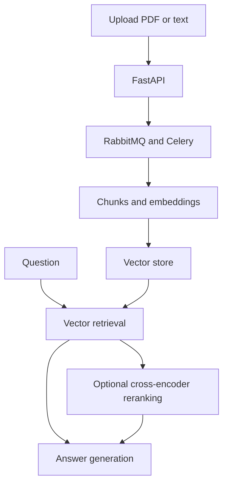

# RAG System

A document question-answering backend built with FastAPI and Celery. Upload a PDF or text file, process and index it, then ask questions against that project's documents.

I use RabbitMQ to queue document work, Redis to store task results, and PostgreSQL with pgvector for semantic retrieval. Qdrant is also available through the vector-store interface. Embeddings and answers use configurable providers; the local Compose stack runs the supporting services on one machine.

## Request flow



Document processing and workflow indexing run in Celery. The search and answer endpoints execute within the API request; they are not background Celery jobs. Uploaded files live in a shared Docker volume.

## What is implemented

- PDF and UTF-8 text ingestion, with project-specific files and chunks.
- Background processing and indexing workflows with task IDs.
- pgvector and Qdrant adapters, plus configurable embedding and generation providers.
- English and Arabic prompt templates.
- Flower task monitoring and a Compose stack with Prometheus and Grafana.
- Optional page-aware overlapping chunks that preserve source metadata.
- Separate reranked search and answer endpoints using a local CPU cross-encoder.
- Paired retrieval evaluation with Recall@k, reciprocal rank at k, and latency.

The reranked path is optional. It does not replace the existing endpoints or change existing indexes. Its benefit on a particular document set needs to be measured; there are no claimed quality improvements without an evaluation run.

## Run locally

Use Python 3.10 and Docker Compose. From the repository root, create the local configuration files from the examples if this is a new installation:

```bash
for service in app postgres rabbitmq redis grafana postgres-exporter; do
    test -f "docker/env/.env.$service" || cp "docker/env/.env.example.$service" "docker/env/.env.$service"
done
test -f docker/minirag/alembic.ini || cp docker/minirag/alembic.example.ini docker/minirag/alembic.ini
```

Edit the copied files before starting. Keep PostgreSQL credentials consistent between the app and database settings. Likewise, the broker URL must match the RabbitMQ user, password and vhost, and the Redis URL must match the running Redis password. The Redis command in Compose uses shell substitution, so export `REDIS_PASSWORD` with the same value when needed. Configure valid model IDs and your own provider keys; example values are placeholders.

An existing working installation can keep its current configuration.

```bash
docker compose -f docker/docker-compose.yml up -d --build
```

Open [API documentation](http://localhost:8000/docs). Keep management ports local or behind appropriate access controls when deploying elsewhere; the example stack is intended for local development.

## Use the API

For one project ID, follow this order:

1. Upload a file through `/api/v1/data/upload/{project_id}`.
2. Call `/api/v1/data/process-and-push/{project_id}` and wait for processing and indexing to complete.
3. Query `/api/v1/nlp/index/search/{project_id}` or `/api/v1/nlp/index/answer/{project_id}`.

Use the same project ID for every step. A newly chosen ID has no indexed documents until its own processing workflow completes.

The existing processing defaults remain `chunk_size=100`, `overlap_size=20`, and `chunk_strategy="legacy"`. The legacy splitter does not apply overlap. For new indexes, the optional `page_overlap` strategy applies real overlap and retains page metadata. See [retrieval setup and evaluation](docs/retrieval.md) for the complete example and trade-offs.

## Repository layout

| Path | Purpose |
| --- | --- |
| `src/routes/` | HTTP endpoints and request schemas |
| `src/controllers/` | Ingestion, retrieval and answer orchestration |
| `src/tasks/` | Celery processing and indexing jobs |
| `src/stores/` | LLM and vector-store provider adapters |
| `src/models/` | Database models, queries and migrations |
| `src/retrieval/` | Optional chunking, reranking and retrieval metrics |
| `docker/` | Service configuration and container build |
| `scripts/` | Model provisioning and evaluation commands |
| `tests/` | Retrieval and compatibility tests |

## Checks

The lightweight checks run without model weights, provider keys or a database:

```bash
python -m pip install pydantic==2.11.10
python -m unittest discover -s tests -v
python -m compileall -q src scripts
```

GitHub Actions runs these checks on Python 3.10 and 3.12. These tests cover retrieval logic and compatibility contracts; a live Compose run is still needed to verify the complete deployment.

## Dependencies and cost

The core service dependencies remain pinned in `src/requirements.txt`. The optional reranker has a separate dependency file and explicit model download. It runs on CPU and does not require a paid inference service. Existing embedding and generation providers remain subject to their own quotas.

The repository uses the Apache 2.0 license in [License](License). The optional cross-encoder is also distributed under Apache 2.0; its model card is downloaded alongside its weights.

## Document workspace

A local browser interface is available for uploading a document, preparing a new project and asking questions. Reranked answers include the context passages and available file/page metadata. The original vector-only answer path is available from the same screen.

With the Docker API already running:

```bash
python run_ui.py
```

Open `http://127.0.0.1:7861`. The UI uses only Python's standard library and local HTML/CSS/JavaScript; it adds no packages to the API or worker environment. See [workspace operation](docs/workspace.md).
